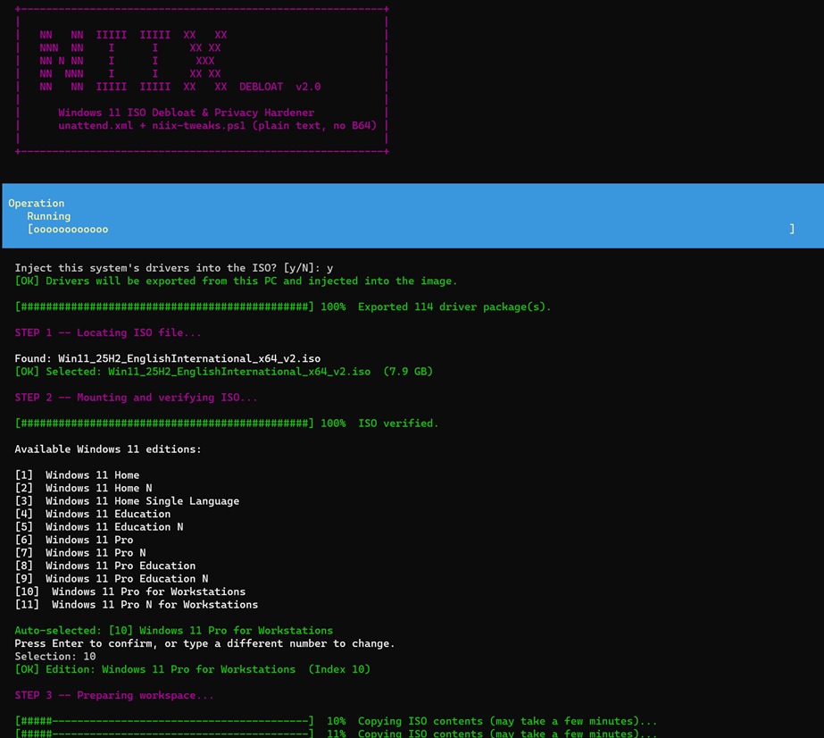

# niixdebloat

by: cuteLiLi / techniix / QuacK / decoi

Turns an official Windows 11 ISO into a debloated, privacy-hardened, gaming-tuned install ISO. Everything is applied automatically during Setup and at first login.

Based on [WinUtil](https://github.com/ChrisTitusTech/winutil) and the [Schneegans unattend generator](https://schneegans.de/windows/unattend-generator/), customised by [techniix](https://github.com/techniixdotcom).



## Files

| File | Purpose |
|---|---|
| `niixdebloat.ps1` | Builds the new ISO |
| `unattend.xml` | Windows Setup answer file |
| `niix-tweaks.ps1` | Post-install tweaks (runs at first login, then silently at every login) |

Keep all three in the same folder.

## Requirements

- Windows 10/11 x64 PC to build on
- Official Windows 11 **x64** ISO from Microsoft
- 25 GB free disk space
- `oscdimg.exe`, installed automatically via `winget` if missing

## Usage

1. Put the three files and your Windows 11 ISO in one folder.
2. Optional: add a `wallpaper.jpg`/`.png` (becomes the default wallpaper) and any `.exe` installers (placed on the desktop, for example a browser).
3. Run:
   ```
   powershell -ExecutionPolicy Bypass -File .\niixdebloat.ps1
   ```
4. Output: `win11_niix_<language>.iso`, for example `win11_niix_de-DE.iso`.
5. Boot it and install. Setup only asks for language, disk, edition and your local account.

## Booting

- **Virtual machine:** mount the ISO, nothing else needed.
- **Rufus:** flash in normal ISO mode. Don't use Rufus's "Customize Windows installation" options.
- **Ventoy:** Ventoy ignores the answer file inside the ISO, so link it separately:
  1. Copy the ISO and `unattend.xml` to the Ventoy USB.
  2. Run `VentoyPlugson.exe` → **Auto Install Plugin** → **Add**.
  3. Set the image to your ISO and the template to `unattend.xml` (both should show **OK**).
  4. Tick **autosel** and set it to `1`.

  If you rename or rebuild the ISO, update the image path in Plugson.

## What it does

**Removes:** Xbox apps, Bing apps, Copilot, Teams, new Outlook, OneDrive, Edge (WebView2 kept), Clipchamp, Solitaire, Feedback Hub, Maps, Mail & Calendar, Windows Backup and other preinstalled apps.

**Privacy:**
- Telemetry, advertising ID, activity history, tips and suggestions off
- Copilot, Recall and AI features off by policy
- Telemetry services and tasks disabled
- Defender stays on but never uploads files
- Hosts file blocks a list of Microsoft telemetry and ad domains

**Interface:** dark mode, classic right-click menu, left-aligned taskbar, no Widgets or search box, empty Start pins, no Recommended section, seconds in the clock.

**Performance:**
- Game Mode and GPU scheduling on; Game Bar, mouse acceleration and fullscreen optimizations off
- Reserved Storage off
- Desktops only: High performance power plan, hibernation and USB power saving off (laptops keep their battery settings)

**Windows Update:** updates download automatically, you choose when to install, no forced restarts while signed in.

**Time sync:**
- Syncs with `time.cloudflare.com` every hour and at every login
- Hardware clock set to UTC, so dual-booting with Linux keeps the right time

**Stays applied:** the tweaks re-run silently at every login, so Windows updates can't undo them. To stop this, disable `NiixTweaksMaintain` in Task Scheduler.

## Good to know

- TPM, Secure Boot and RAM checks are bypassed.
- SmartScreen and Memory Integrity (VBS) are off for performance. Turn them back on in Windows Security if you need them.
- Defender may flag the hosts-file changes as `HostsFileHijack`. Choose "Allow on device" to keep them.
- Logs: `Documents\NiixDebloat-Logs`

## License

Personal use. Based on WinUtil (MIT) and the Schneegans unattend generator. Use at your own risk, and test in a VM first.
